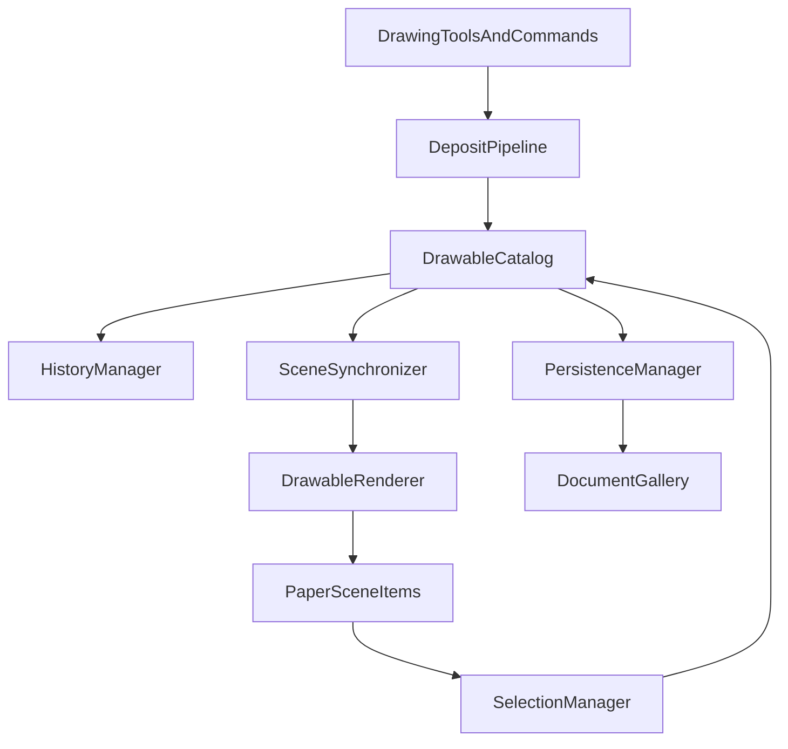

Currently Paper.js is doing more than rendering:

- The active Paper layer is often treated as the list of document content.
- Many drawing tools create and modify Paper items directly.
- Undo/redo commonly restores Paper scene state.
- Gallery persistence uses Paper scene JSON via `SceneIO`.
- On reload, Paper reconstructs its items from that scene data.

`NGDrawable` can represent document data, and `DrawableRenderer` can regenerate Paper items from it, but that model-first path is only used for selected cases.

The refactor reverses ownership:

```text
Document model → renderer → Paper.js scene
```

instead of the current common flow:

```text
Paper.js scene → persistence / retained-source bridge
```

Paper.js would still load/render derived items, handle hit testing, and support canvas interaction. It just would no longer determine what the document contains.


Once the document model is authoritative, Paper.js becomes a replaceable rendering and interaction adapter.

A future migration could be:

```text
NGDrawable document model
        ↓
DrawableRenderer interface
        ↓
Paper.js renderer → Canvas/WebGL/SVG renderer
```

The replacement renderer would need to implement drawing, hit testing, layer ordering, transforms, and export behavior. But documents, persistence, undo/redo, semantic shapes, and most tool decisions would remain independent of Paper.js.

That is a major reason to establish the one-way model-to-renderer boundary now.

---
name: document-scene-refactor
overview: "Turn the model/document architecture already present in the repository into the live source of truth, then use that stable spine to simplify engine orchestration and UI command routing. The plan prioritizes navigability: every persisted drawable, derived Paper.js item, mutation, and command should have one discoverable owner."
todos:
  - id: catalog-sync
    content: Define the drawable catalog and production scene-synchronization contracts.
    status: completed
  - id: deposit-history
    content: Migrate path/shape deposits and history to model-first mutations.
    status: pending
  - id: persistence
    content: Add native versioned document persistence with legacy scene migration.
    status: pending
  - id: facade-ui
    content: Finish facade, host-port, and UI document-command boundary cleanup.
    status: pending
isProject: false
---

# Document and Scene Refactor Plan

## Goal

Replace the present Paper.js-first / partially retained-model architecture with a document-owned drawable catalog and a one-way render pipeline. Make `NGDrawable` data the authoritative source for migrated document content, retain Paper.js items as derived scene objects, and leave `NibGliderEngine` as a thin compatibility facade.

This is the highest-leverage navigability refactor because the current code has already extracted model, renderer, history, and document primitives, but production drawing and persistence still bypass them. Splitting `engine.ts` or `ControlPanel.tsx` first would move that ambiguity into new files rather than remove it.

## Evidence and scope

- [`src/engine/engine.ts`](/Users/jpratt/Developer/nibglider/src/engine/engine.ts) remains about 5,900 lines and directly orchestrates deposits, retained paths, history, scene import/export, and Paper.js items.
- [`src/engine/scene/SceneRepository.ts`](/Users/jpratt/Developer/nibglider/src/engine/scene/SceneRepository.ts) maintains both `records` and `modelItems`; neither is the complete document catalog.
- [`src/engine/scene/DrawableRenderer.ts`](/Users/jpratt/Developer/nibglider/src/engine/scene/DrawableRenderer.ts) and model-history support are exercised in tests but are not the normal production rendering/deposit path.
- [`src/ui/DocumentGallery.ts`](/Users/jpratt/Developer/nibglider/src/ui/DocumentGallery.ts) currently stores Paper scene JSON, while [`src/engine/model/serialization.ts`](/Users/jpratt/Developer/nibglider/src/engine/model/serialization.ts) already supplies model serialization primitives.
- Text, images, groups, interlace, and arbitrary imported Paper content do not yet have complete model resolvers. They must remain supported through an explicit compatibility boundary during the migration.

## Architectural contract



1. `DrawableCatalog` owns ordered, page-scoped `NGDrawable` records and their stable IDs.
2. `SceneSynchronizer` is the only production path that creates, updates, or removes derived content Paper.js items for catalog entries.
3. `DrawableRenderer` resolves model geometry and tags every derived item with its `drawableId`; it never becomes a second source of document state.
4. `DepositPipeline` converts tool or command output into model data before it is committed; operations that cannot preserve source semantics explicitly lower to a Bezier or compound-path drawable.
5. `HistoryManager` records catalog mutations as model transactions, restores model first, and asks synchronization to refresh derived items.
6. Existing Paper-only content remains behind a named compatibility adapter until its source kind is fully modeled. It must not silently masquerade as model-authoritative content.

## Non-goals

- Do not redesign every tool, every UI panel, or all document file formats in the first increment.
- Do not require text, raster images, SVG groups, and interlace to gain semantic source models before path and shape migration begins.
- Do not delete support for legacy `nibglider-scene` gallery records; preserve a migration/import path.
- Do not change user-visible drawing, selection, layering, undo/redo, export, or gallery behavior while moving responsibilities.

## Phases

### Phase 1: Define catalog and synchronization contracts

Create a production document-model API before migrating any tool.

- [x] Add `DrawableCatalog` under `src/engine/document/` or extend `DocumentManager` with a cohesive page-scoped catalog implementation; choose one name and make it the only API for content-model lookup.
- [x] Define explicit API operations: `get`, `has`, `ordered`, `upsert`, `remove`, `replaceAll`, and `clearPage`; preserve draw order, `pageId`, and `layerId`.
- [x] Establish ID rules: a drawable ID is stable through transform/style edits and changes only on duplication or conversion to a materially new result.
- [x] Write a catalog ownership header documenting state it owns, state it reads, mutations it permits, emitted change events, and test location.
- [x] Add a `SceneSynchronizer` service that accepts catalog changes and provides `rebuildDrawable`, `removeDrawable`, and `rebuildPage`.
- [x] Construct `DrawableRenderer` and `SceneSynchronizer` in the production composition root and expose them through `EngineContext` using typed fields.
- [x] Ensure every derived content Paper.js item receives `drawableId`, and centralize its creation/removal through synchronizer/renderer paths.
- [x] Convert `SceneRepository.modelItems` and retained-path accessors into temporary catalog adapters; do not maintain duplicate writable maps.
- [x] Add focused tests for ordering, page isolation, ID preservation, renderer tags, single-item rebuild, and page rebuild.

Exit criteria:

- A feature can answer “what is the authoritative source for drawable X?” by starting at one catalog API.
- Rebuilding a catalog-backed path/shape item never requires the original Paper.js content item.
- `SceneRepository` has no independent writable model-item authority.

### Phase 2: Establish a model-first deposit pipeline

Move new path/shape content through a single, discoverable commit boundary.

- [ ] Add `DepositPipeline` under `src/engine/scene/` or `src/engine/drawing/`, with narrow dependencies on catalog, geometry lowering policy, synchronizer, and history transaction entry points.
- [ ] Define a deposit result discriminated union for semantic preservation, Bezier lowering, compound-path lowering, and explicit legacy/Paper compatibility deposit.
- [ ] Move composite path completion from `NibGliderEngine.retainCompositeResult` into the pipeline: produce an `NGPathDrawable`, catalog it, render it, and record one model history command.
- [ ] Keep selection, snap feedback, and preview cleanup as callers/observers; they must not insert catalog entries themselves.
- [ ] Migrate rectangle/circle/shape deposits wherever existing descriptor methods can produce `NGShapeDrawable`; preserve semantic parameters only while invariants hold.
- [ ] For regular legacy path tools, lower final Paper geometry to a Bezier `NGPathDrawable` at deposit time until tool sessions become model-native.
- [ ] Route boolean/combinatorics results through `booleanResolver` and the deposit result policy rather than directly depositing Paper items.
- [ ] Add migration tests for composite paths, semantic rectangles/shapes, lowered paths, selection mapping, one-step undo/redo, and preserved ordering.

Exit criteria:

- New composite paths and supported semantic shapes exist in the catalog before a final Paper item exists.
- One logical drawing action creates one catalog mutation and one undoable history entry.
- No tool needs to know `SceneRepository.records` internals.

### Phase 3: Bridge history, selection, and transforms safely

Make catalog changes the ordering point for model-backed edits without breaking legacy Paper scene history.

- [ ] Promote `HistoryManager.recordModelChange` and its model command host from test-only support to a production dependency of catalog-backed mutations.
- [ ] Define a command discriminant for `model` versus `legacyScene` history entries; retain a single ordered undo stack during migration.
- [ ] Specify command ordering: restore catalog snapshot or mutation result, synchronize derived items, restore selection by `drawableId`, then notify UI.
- [ ] Add transaction helpers for multi-item deposits, transforms, group operations, boolean operations, and import; no partial command may survive a failed operation.
- [ ] Update `SelectionManager` to resolve content identity through `drawableId` and catalog lookup for migrated items, while retaining legacy fallback behavior only in one adapter.
- [ ] Update transform paths so catalog-backed transforms modify drawable transform/source data first, then synchronize; do not persist a Paper matrix as the authoritative result.
- [ ] Document and test coalescing for pointer drag transforms and repeated keyboard nudges.

Exit criteria:

- Undo/redo of a migrated drawable rebuilds it from model data and preserves selection/order.
- History code does not need to inspect live Paper segment data to restore migrated content.
- Legacy Paper-only history remains functional and clearly isolated.

### Phase 4: Introduce native document persistence with compatibility migration

Add a versioned model document format while preserving existing gallery content.

- [ ] Define `nibglider-document` version 1: document metadata, pages, layer metadata, ordered catalog drawables, view state, style references, and optional compatibility entries.
- [ ] Add `PersistenceManager` in `src/engine/document/` to own encode/decode, schema validation, migration dispatch, and structured load failures.
- [ ] Keep `SceneIO` as the legacy Paper scene codec; rename/export its role clearly rather than expanding it into a second native format.
- [ ] Implement import of existing `nibglider-scene` gallery payloads through an adapter that infers safe Bezier catalog entries where possible and preserves unsupported content as named compatibility entries.
- [ ] Update `DocumentGallery` to store the native document payload for migrated documents and read both native and legacy payloads.
- [ ] Make loading transactional: parse/validate into temporary document state, resolve assets/compatibility entries, then replace catalog/scene only after success.
- [ ] Add round-trip and failure tests for native paths/shapes, draw order, page/layer metadata, native-to-native load, legacy scene import, and malformed payload recovery.

Exit criteria:

- A catalog-backed document can save, reload, and rebuild its Paper scene without Paper JSON as source of truth.
- Existing gallery documents can still open, with any fidelity limitations explicit and test-covered.
- File boundaries live in `PersistenceManager`, not `App.tsx`, `ControlPanel.tsx`, or the engine facade.

### Phase 5: Migrate remaining source kinds deliberately

Expand semantic coverage only after the catalog loop is stable.

- [ ] Write the operation matrix promised in `refs/engine-refactor-plan.md` for path, semantic shape, live text, raster image, SVG/vector import, group, mask, and interlace result.
- [ ] Model live text, image boundaries/masks, and groups incrementally; each source kind must state resolver availability, selection behavior, transform policy, serialization form, and lowering behavior.
- [ ] Keep raster crop/subtraction as a mask/clipping policy, not a false vector boolean result.
- [ ] Migrate imports through `DepositPipeline` only when the corresponding resolver and persistence contract exist.
- [ ] Adapt `InterlaceManager` and combinatorics to consume catalog sources rather than `records`/live Paper assumptions.
- [ ] Remove compatibility entries only after their source kind has renderer, history, persistence, and import/export coverage.

Exit criteria:

- Each drawable kind has one documented source/resolve/lower lifecycle.
- Unsupported operations return a structured unavailable result instead of silently flattening or corrupting model state.

### Phase 6: Finish facade and UI boundary cleanup

Use the stable document spine to remove orchestration gravity from the engine and UI shells.

- [ ] Move deposit/export/replace-scene orchestration from `engine.ts` into `DepositPipeline` and `PersistenceManager`; retain only compatibility delegates on `NibGliderEngine`.
- [ ] Split remaining `engine.ts` domains into focused facade services after they call catalog/pipeline APIs, prioritizing text, transform overlays, and import/export.
- [ ] Replace `hosts.ts` `Surface = any` callbacks with narrow typed ports implemented by adapters over `EngineContext`, catalog, and domain services.
- [ ] Move constraints/helper functions out of `KeySettingsRegistry` so geometry and appearance no longer depend on the input settings registry.
- [ ] Add `src/engine/public.ts` with stable public types/view DTOs so React does not import engine internals solely for types/helpers.
- [ ] Extract a UI `commandRegistry` and dispatcher that routes document/open/save/export commands to `PersistenceManager`/document-session APIs; remove duplicated menu command inventories.
- [ ] Refactor document/gallery lifecycle into one UI document-session owner after native persistence is available.

Exit criteria:

- `engine.ts` is composition plus thin compatibility delegation, not a mutable scene/document store.
- Input and drawing modules depend on typed capability ports rather than the whole facade.
- UI command routing has one inventory and one document-session owner.

## Verification after every phase

- [ ] Run `npm run test`.
- [ ] Run `npm run lint`.
- [ ] Exercise path, spline/composite, shape, selection, transform, undo/redo, booleans, import/export, gallery save/load, and canvas attach/detach behavior relevant to the phase.
- [ ] Confirm duplicate ownership has decreased: no second writable model map, no direct content Paper-item creation outside renderer/synchronizer, and no new facade-only state.
- [ ] Inspect the diff for backward-compatibility behavior and a clearly documented migration path.
- [ ] Keep refactor slices reviewable and independently reversible.

## Definition of done

- `NGDrawable` catalog records, not Paper.js items or a partial retained-path map, are authoritative for supported document content.
- Paper.js content items are derivable, tagged, and managed through `SceneSynchronizer` and `DrawableRenderer`.
- New migrated content is deposited, selected, transformed, undone/redone, saved, and loaded through model-first APIs.
- Legacy scene payloads and unsupported source kinds have explicit, tested compatibility behavior.
- `engine.ts`, gallery persistence, and UI command dispatch expose clear ownership boundaries rather than acting as cross-domain mutation hubs.
- An agent can trace a drawable from command to persisted model to rendered Paper item by following the modules named in this plan.